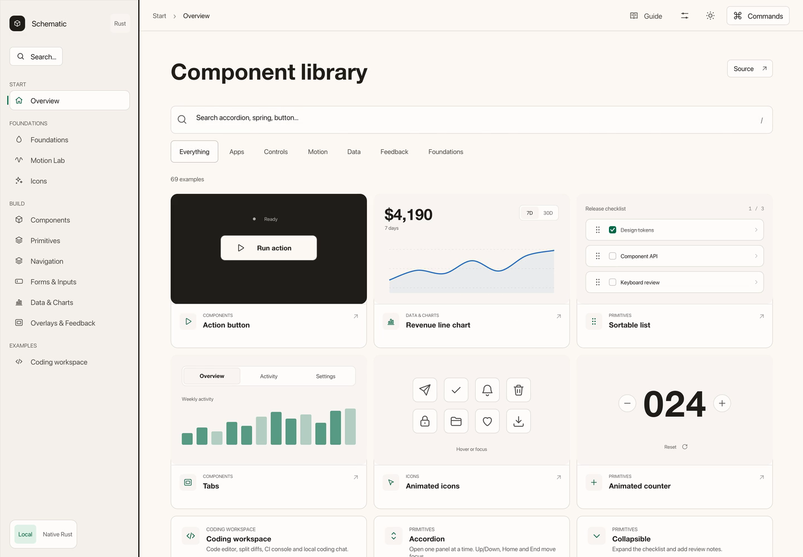
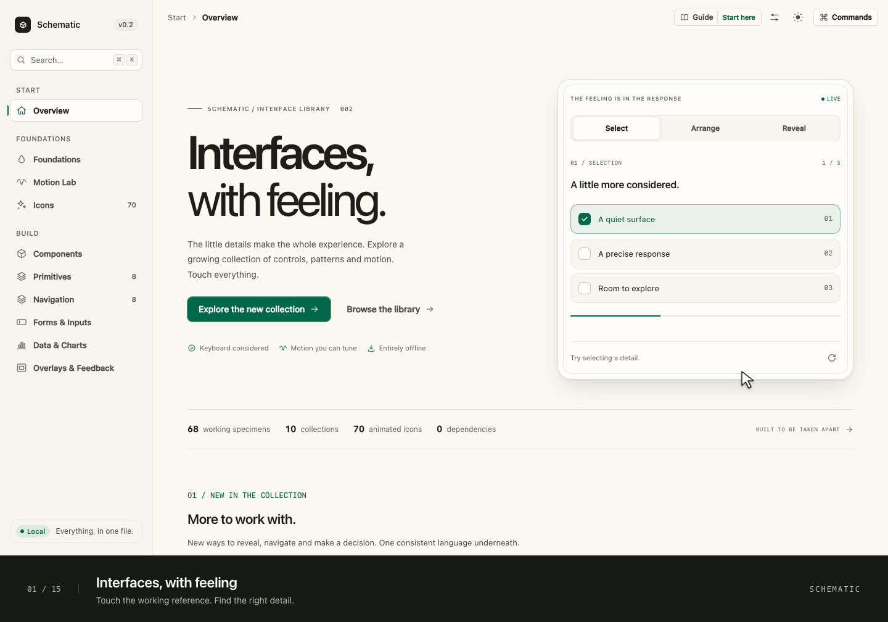

# Schematic

An offline component library with a web reference and a native Rust application.
Browse working previews, test interactions and inspect the source.

[Try the live reference](http://dodothereal.me/schematic/) ·
[Quick start](docs/QUICKSTART.md) ·
[Watch the walkthrough](http://dodothereal.me/schematic/watch/) ·
[MIT license](LICENSE)

## Native Rust app

The native application uses Rust with eframe/egui. Layout, controls, vector icons,
state and animation are authored in Rust. It has no browser, WebView, JavaScript
engine or HTML/CSS renderer. The web reference remains available separately.

[Download for macOS Apple Silicon](https://github.com/Dodothereal/schematic/releases/tag/native-v0.1.1) ·
[Build and reuse the Rust code](rust/README.md) ·
[Native parity and verification](rust/PARITY.md)

```sh
cargo run --release --manifest-path rust/Cargo.toml
```

The native app includes the eleven routes, 69 specimens, 82 animated vector icons,
optional guide, Color/Mono palettes and local coding workspace. The workspace
simulates repairs, CI checks, approvals and merges; it does not run a backend.

[](rust/docs/assets/native-walkthrough.mp4)

[Watch the native recording](rust/docs/assets/native-walkthrough.mp4) ·
[Chapters and transcript](rust/docs/WALKTHROUGH.md)

[](https://github.com/Dodothereal/schematic/actions/workflows/ci.yml)

[](http://dodothereal.me/schematic/watch/)

The walkthrough records the actual application, including drag sorting and a
coding-chat demo with diffs, pull requests, CI logs and a merge flow.
[Watch with captions and chapters](http://dodothereal.me/schematic/watch/),
[download the MP4](docs/assets/schematic-walkthrough.mp4), or
[read the transcript](docs/WALKTHROUGH.md).

## Open it. No setup.

Download [schematic.html](https://github.com/Dodothereal/schematic/releases/latest/download/schematic.html)
and open it in a current browser. Everything is in that file: no installation,
server, account, CDN or network request.

Prefer black and white? Download
[schematic-mono.html](https://github.com/Dodothereal/schematic/releases/latest/download/schematic-mono.html).
The interface stays neutral while chart series keep distinct colours.

Or work from the source:

```sh
git clone https://github.com/Dodothereal/schematic.git
cd schematic
# Open prototype/index.html in your browser.
```

**Start with Guide in the top bar.** The optional four-step tour lets you choose
a palette, try a motion and find the reuse path. It never interrupts a first
visit with an automatic modal. You can close and reopen it at any time.

## What is inside

| Area | What you can actually do |
| --- | --- |
| **Foundations** | Inspect semantic colours, type, spacing and surfaces; export a resolved token snapshot. |
| **Motion Lab** | Compare and scrub easing curves, tune a physical spring, copy its sampled curve and replay choreography. |
| **Icons** | Search 82 animated SVG icons, change size and stroke, play a wave and copy usage. |
| **Components** | Try pending/success/retry states, cancel a hold, switch tabs, select chips and operate menus with a keyboard. |
| **Primitives** | Expand disclosures, drag files between pinned/unpinned groups, sort tasks with a pointer or keyboard, change text and numbers, and flip cards. |
| **Navigation** | Operate a moving menu, searchable combobox, breadcrumbs, pagination, file tree, dock, validated steps and carousel. |
| **Forms & Inputs** | Validate fields, reveal a password, paste an OTP, manipulate ranges and edit a composed profile. |
| **Data & Charts** | Watch plots draw into view, change ranges, inspect linked values, pin details and export selected table rows. |
| **Overlays & Feedback** | Open origin-aware dialogs, drawers and sheets; try menus, tooltips, toasts and loading states. |
| **Coding workspace** | Edit highlighted source, compare split diffs, inspect CI logs, request a simulated repair, review and merge a PR. |

The reference has eleven routes including Overview. The home page starts with
search and working component previews. Run an action, inspect a chart, drag
tasks, switch tabs or try the icons and counter directly in the catalog.
Each result also opens its full working example. Pages prepare on intent and
during idle time, retain their DOM and restore scroll position on return.
Cmd/Ctrl-K opens the command palette.

Search and category changes animate the matching results while retaining each
preview's state. The category indicator also follows filters that wrap on mobile.

The coding workspace uses a code editor, split diff and CI console. Chat sits
beside the code.
The coding workspace is local: it does not contact an AI, Git or CI service.
Primitives and Navigation contain sixteen standalone specimens.
Their motion studies take inspiration from
[Animate UI](https://animate-ui.com/docs/primitives), with original vanilla
implementations using Schematic's own tokens and runtime.
[Design notes](docs/DESIGN_NOTES.md) explain the visual and interaction choices.

## A language, not just a resting state

- **Meaningful motion.** Hover reveals intent or information. Icons perform their
  verb. Graphs trace their final geometry instead of growing from zero. A new
  range starts a fresh, interruptible draw.
- **A shared rhythm.** Semantic tokens govern colours, a 4px spacing scale,
  typography, radii, control sizes, durations and curves.
- **Four appearances.** Warm paper and graphite with a restrained forest accent,
  or Mono; each supports light and dark. Theme reveals include the background.
- **Useful interaction details.** Whole-row selection, animated checkmarks,
  keyboard chart inspection, linked legends, focus restoration and local state.
- **Motion preferences.** System reduced motion applies unless Full is explicitly
  selected. Slow-mo lets you inspect timing. A confirmation hold still takes
  the same amount of real time.
- **Small, direct technology.** Vanilla HTML, CSS, JavaScript and SVG. No runtime
  packages, web fonts, tracking, stock footage or external asset service.

## Bring it into a project

Start with [the quick start](docs/QUICKSTART.md), then
[the design guide](DESIGN_GUIDE.md). Reuse the semantic tokens and the specific
styles, SVG paths and behavior your interface needs.

```text
prototype/
  css/tokens.css     the design source of truth
  css/base.css      layout, type, controls and application shell
  css/ui.css        shared interaction styles
  js/               icons, motion helpers, feedback, routing and preferences
  pages/            working examples
  css/pages/        styles scoped to each page
dist/
  schematic.html        offline reference
  schematic-mono.html   offline Mono entry
docs/
  QUICKSTART.md     first run and reuse guide
  watch/            accessible walkthrough player
  assets/           recording, poster, captions and chapter metadata
```

Page authors should read [the page contract](prototype/CONTRACT.md). It defines
registration, pure rendering, mounting, entry and cleanup. The showcase pages
are complete examples to adapt; they are not packaged drop-in components.

**Implemented:** the web reference and [native Rust application](rust/README.md).
**Planned:** React/Next.js and SwiftUI adapters. The [native parity ledger](rust/PARITY.md)
records the verification scope and remaining platform checks.

## Build and verify

Node 22.13+ is needed for tooling. There are no npm dependencies to install.

```sh
npm run build
npm run check
npm run test:browser
```

The build generates the portable HTML files and token-name manifest. Structural
checks catch missing assets and stale output. Browser checks launch an isolated
Chrome profile and exercise the actual interface, including normal-speed guide
frames, interrupted transitions and keyboard access on narrow screens.
Set `SCHEMATIC_CHROME` to an
installed Chrome/Chromium executable if automatic discovery cannot find it.

[Verification notes](VERIFICATION.md) describe the checked scope and limits.
[Contributing](CONTRIBUTING.md) explains how to keep new work consistent.
[The roadmap](ROADMAP.md) prioritises reusable recipes, broader runtime coverage
and the first measured framework adapter.

## Scope and honesty

Async actions, uploads, profile saves and analytics are explicitly local demos.
They do not contact a backend or upload file contents. Preferences use local
browser storage when available; moving a local HTML file may reset them.
Product composition and real service integration belong to your application.

The recording uses the real interface with local synthetic narration. Captions,
chapter controls and a written transcript accompany it. The optional recording
tool uses Chrome, FFmpeg and the macOS speech synthesizer; the app itself does
not need any of them.

The live Pages site inherits the account's existing `dodothereal.me` domain and
currently uses HTTP while that account-level site lacks a valid HTTPS certificate.
The repository, release downloads and MP4 download are served over HTTPS by GitHub.

Created by [Dodothereal](https://github.com/Dodothereal). Released under the
[MIT license](LICENSE).
